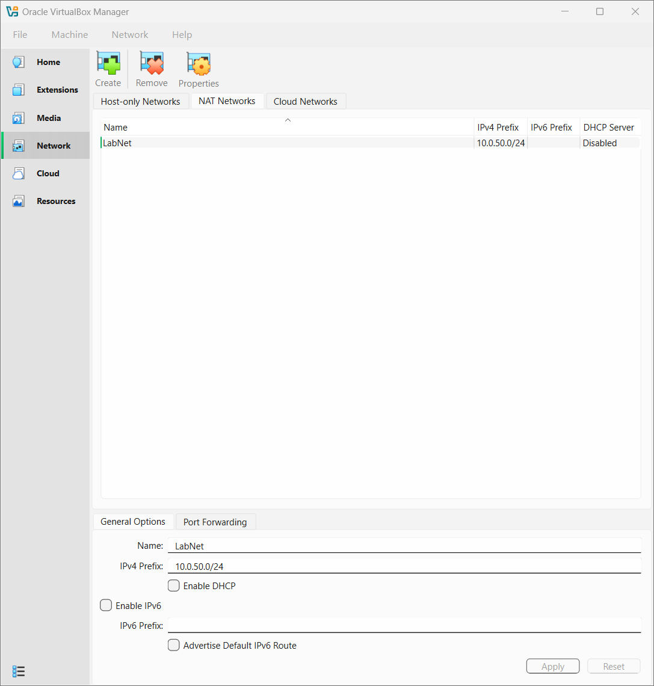
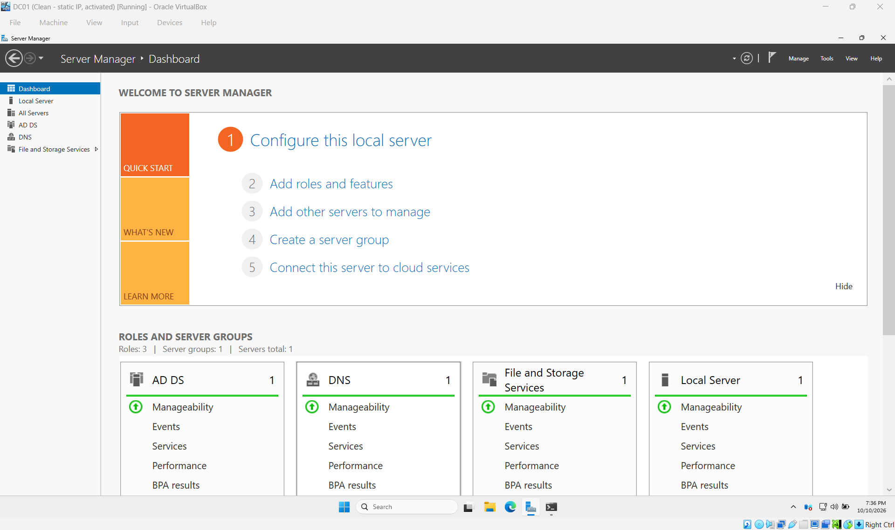
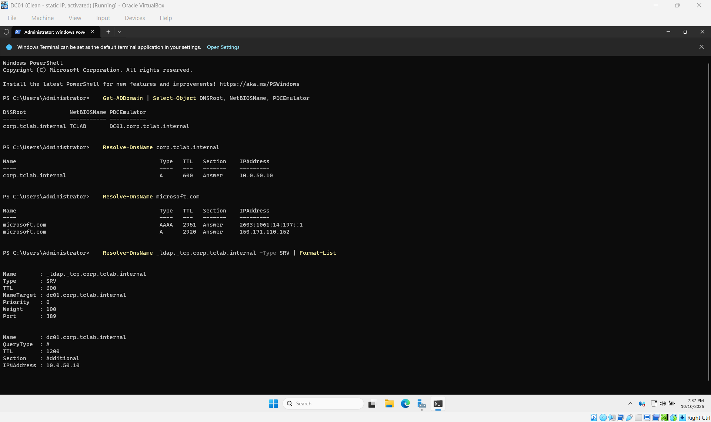
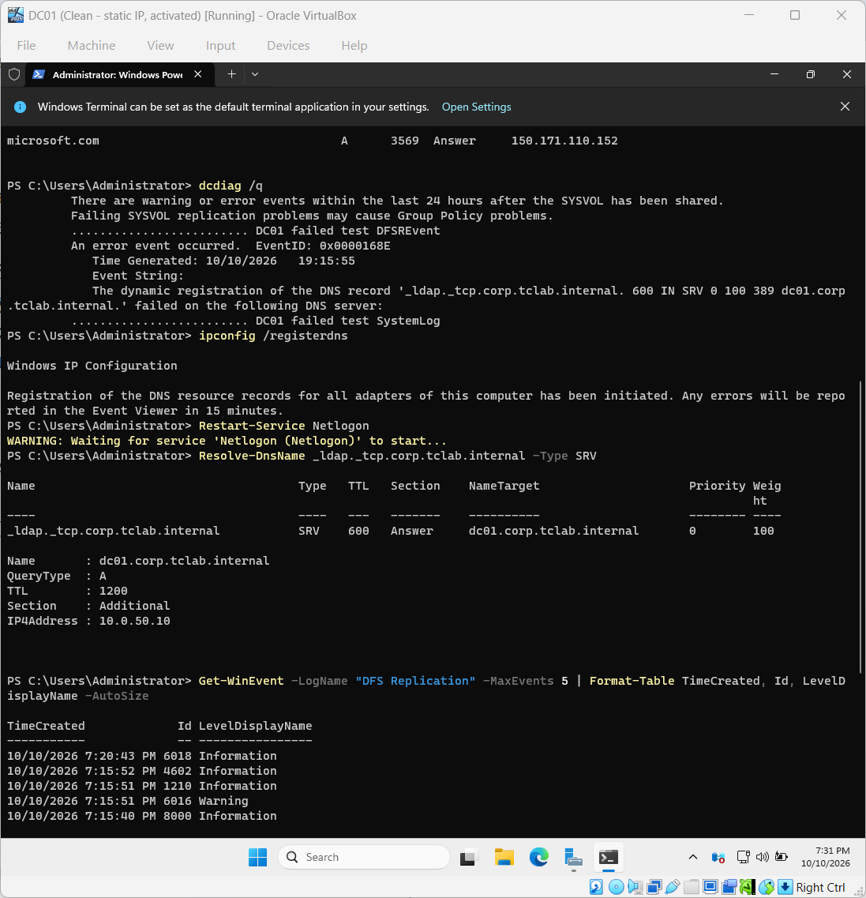

# Lab notes

Commands and decisions, in the order I ran them. Each section ends with what I checked and anything that went wrong.

**Contents:** [Q00 Setup](#q00-setup-oct-9-2026) · [Q01 Domain controller](#q01-domain-controller-oct-10-2026) · [Q02 Client join](#q02-client-join-oct-10-2026) · [Q03 Users and groups](#q03-users-groups-and-password-resets-oct-13-2026) · [Q04 Group Policy](#q04-group-policy-and-account-lockout-oct-13-2026) · [Q05 File share](#q05-file-share-and-drive-mapping-oct-13-2026)

| Machine | OS | Address | Role |
| --- | --- | --- | --- |
| DC01 | Windows Server 2025 Standard Evaluation | 10.0.50.10 | Domain controller, DNS, file share |
| CLIENT01 | Windows 11 Enterprise Evaluation | 10.0.50.21 | Domain-joined workstation |

Domain: `corp.tclab.internal` (NetBIOS `TCLAB`) · Network: VirtualBox NAT network "LabNet", 10.0.50.0/24

## Q00 Setup (Oct 9, 2026)
- Laptop: Lenovo IdeaPad Flex 5, 16 GB RAM, Windows 11 Home, VirtualBox 7
- NAT Network "LabNet": 10.0.50.0/24, gateway 10.0.50.1, DHCP off
  (private range, avoids home 192.168.x.x and VirtualBox's 10.0.2.x)
- Ticket: Microsoft eval form looped in a normal window, worked in Incognito



## Q01 Domain controller (Oct 10, 2026)
- VM DC01: Windows Server 2025 Standard Evaluation (Desktop Experience),
  4 GB RAM, 2 CPUs, 50 GB dynamic disk, adapter on LabNet
- Unattended install off, Guest Additions installed, shared clipboard on
- `Get-NetAdapter` showed the adapter is named "Ethernet" (ifIndex 6)
- Server Manager said "assigned by DHCP", but LabNet has no DHCP server,
  so it had likely given itself an APIPA (169.254.x.x) address

Static IP, temporary public DNS, rename:
```powershell
New-NetIPAddress -InterfaceAlias "Ethernet" -IPAddress 10.0.50.10 -PrefixLength 24 -DefaultGateway 10.0.50.1
Set-DnsClientServerAddress -InterfaceAlias "Ethernet" -ServerAddresses 1.1.1.1
Rename-Computer -NewName "DC01" -Restart
```
- Checked with `ipconfig /all`: host DC01, DHCP off, 10.0.50.10/24,
  gateway 10.0.50.1, DNS 1.1.1.1
- Activated the evaluation with `slmgr /ato` (180 days)

### AD DS and DNS
```powershell
Install-WindowsFeature AD-Domain-Services -IncludeManagementTools
Install-ADDSForest -DomainName "corp.tclab.internal" -DomainNetbiosName "TCLAB" -InstallDns
Set-DnsClientServerAddress -InterfaceAlias "Ethernet" -ServerAddresses 10.0.50.10
Add-DnsServerForwarder -IPAddress 1.1.1.1
```
- The forwarder was already set. The promotion carried 1.1.1.1 over from the old DNS setting.
- Checked with `Get-ADDomain`, `Resolve-DnsName corp.tclab.internal` (10.0.50.10) and `Resolve-DnsName microsoft.com`




### Troubleshooting: dcdiag failures after first boot
- `dcdiag /q` failed DFSREvent and SystemLog
- SystemLog: event 5774, Netlogon couldn't register the `_ldap._tcp` SRV record at 7:15 PM (first boot)
- DFSREvent: a 6016 warning in the DFS Replication log at the same minute
```powershell
ipconfig /registerdns
Restart-Service Netlogon
Resolve-DnsName _ldap._tcp.corp.tclab.internal -Type SRV
Get-WinEvent -LogName "DFS Replication" -MaxEvents 5
```
- Result: SRV record resolves to dc01 (10.0.50.10), event 4602 shows SYSVOL initialized, and SYSVOL and NETLOGON are shared. Both errors came from the first boot, not a live problem.
- Oct 13: `dcdiag /q` came back clean once the 24-hour window had passed




## Q02 Client join (Oct 10, 2026)
- VM CLIENT01: Windows 11 Enterprise Evaluation, 4 GB RAM, 2 CPUs,
  64 GB dynamic disk (Windows 11 setup needs at least 64 GB), adapter on LabNet, local account labadmin
```powershell
New-NetIPAddress -InterfaceAlias "Ethernet" -IPAddress 10.0.50.21 -PrefixLength 24 -DefaultGateway 10.0.50.1
Set-DnsClientServerAddress -InterfaceAlias "Ethernet" -ServerAddresses 1.1.1.1
Set-TimeZone -Id "Pacific Standard Time"
slmgr /ato
```

### Joining the domain
Pointed DNS at the domain controller and tested before joining. Port 389 is LDAP, which the join needs:
```powershell
Set-DnsClientServerAddress -InterfaceAlias "Ethernet" -ServerAddresses 10.0.50.10
Resolve-DnsName corp.tclab.internal
Test-NetConnection DC01.corp.tclab.internal -Port 389
Add-Computer -DomainName "corp.tclab.internal" -NewName "CLIENT01" -Credential TCLAB\Administrator -Restart
```
Checked as TCLAB\Administrator on CLIENT01, then on DC01:
```cmd
hostname
whoami
nltest /dsgetdc:corp.tclab.internal
```
```powershell
Get-ADComputer -Filter * | Select-Object Name
```
- `nltest` found DC01 at 10.0.50.10, and AD listed DC01 and CLIENT01


### Troubleshooting
- Fresh install showed "Windows License is expired". `slmgr /dlv` said grace time expired (0xC004F009). The evaluation had never activated because the VM had no network yet. Gave it an address, ran `slmgr /ato`, now Licensed for 90 days.
- First `slmgr /ato` failed with 0x80072EE7 (name not resolved). `Test-NetConnection 1.1.1.1 -Port 53` succeeded, so routing was fine. Reran it a minute later and it worked. Likely ran before the new IP finished coming up.
- `Add-Computer -NewName` joined the domain but failed the rename ("The directory service is busy"). Restarted to finish the join, signed in as TCLAB\Administrator, ran `Rename-Computer -NewName CLIENT01 -Restart`, then checked with hostname, whoami, `nltest /dsgetdc` and `Get-ADComputer`. Next time: rename first, then join.
- VM was very slow during the Guest Additions install. VirtualBox showed Execution Engine: native API, Nested Paging: Inactive. Hyper-V is active on the host (likely for Memory Integrity), so VirtualBox runs on top of it in a slower mode. Left it on for now.

## Q03 Users, groups and password resets (Oct 13, 2026)
- Built an OU structure: Lab > Staff (Recreation, Finance, IT), Workstations, Groups
- Moved CLIENT01 into Workstations and sent new computers there by default with `redircmp`
- Created four users in bulk from [scripts/users.csv](scripts/users.csv) with [scripts/new-lab-users.ps1](scripts/new-lab-users.ps1). Each user has to set a new password at first sign-in.
- Created security groups GG-Recreation, GG-Finance and GG-IT, and added each user to their department group

```powershell
$base = "DC=corp,DC=tclab,DC=internal"
New-ADOrganizationalUnit -Name "Lab" -Path $base
"Staff","Workstations","Groups" | ForEach-Object { New-ADOrganizationalUnit -Name $_ -Path "OU=Lab,$base" }
"Recreation","Finance","IT" | ForEach-Object { New-ADOrganizationalUnit -Name $_ -Path "OU=Staff,OU=Lab,$base" }
Get-ADComputer CLIENT01 | Move-ADObject -TargetPath "OU=Workstations,OU=Lab,$base"
redircmp "OU=Workstations,OU=Lab,DC=corp,DC=tclab,DC=internal"
"Recreation","Finance","IT" | ForEach-Object {
  New-ADGroup -Name "GG-$_" -GroupScope Global -GroupCategory Security -Path "OU=Groups,OU=Lab,$base"
}
Add-ADGroupMember -Identity "GG-Recreation" -Members srivera,pnair
Add-ADGroupMember -Identity "GG-Finance" -Members lmartin
Add-ADGroupMember -Identity "GG-IT" -Members achen
```


### Password reset drill
- Reset Sam Rivera's password in ADUC with "User must change password at next logon" ticked, then again in PowerShell
- `PasswordLastSet` stays blank until the user sets their own password
- Signed in on CLIENT01 as TCLAB\srivera: Windows forced the password change, and `whoami /groups` showed TCLAB\GG-Recreation
- Sam is a standard user (BUILTIN\Users, Medium Mandatory Level), not a local admin

```powershell
Set-ADAccountPassword -Identity srivera -Reset -NewPassword (Read-Host "New temporary password" -AsSecureString)
Set-ADUser -Identity srivera -ChangePasswordAtLogon $true
Get-ADUser srivera -Properties Department, PasswordLastSet, LockedOut, MemberOf
```


## Q04 Group Policy and account lockout (Oct 13, 2026)
- Default Domain Policy: lock an account after 5 bad attempts for 15 minutes, and reset the counter after 15 minutes. Lockout settings for domain accounts only work from a GPO linked at the domain level.
- New GPO "WS - Security Baseline" linked to the Workstations OU: the screen locks after 600 seconds idle, and a logon banner shows before sign-in
- `gpresult /r /scope computer` on CLIENT01 showed both GPOs applied from DC01

```powershell
New-GPO -Name "WS - Security Baseline" | New-GPLink -Target "OU=Workstations,OU=Lab,DC=corp,DC=tclab,DC=internal"
```

```cmd
gpupdate /force
gpresult /r /scope computer
gpresult /h C:\Temp\gpreport.html /f
```


### Lockout drill
- Signed in as srivera with the wrong password 5 times. The next attempt showed "The referenced account is currently locked out and may not be logged on to."
- On DC01, `Search-ADAccount` found the locked account, `Get-ADUser` showed BadLogonCount 5 with the last bad attempt at 1:20:12 PM, and Security event 4740 named the caller computer as CLIENT01
- Unlocked the account with `Unlock-ADAccount` and confirmed Sam could sign in

```powershell
Search-ADAccount -LockedOut | Select-Object Name, SamAccountName
Get-ADUser srivera -Properties LockedOut, BadLogonCount, LastBadPasswordAttempt
Get-WinEvent -FilterHashtable @{LogName='Security'; Id=4740} -MaxEvents 5 | Format-List TimeCreated, Message
Unlock-ADAccount -Identity srivera
```


### Notes
- Signing in as plain "Administrator" on CLIENT01 tries the local account, which is disabled. Domain accounts need TCLAB\ in front.
- "Allow Administrator account lockout" is enabled in this domain's policy, so the domain Administrator can be locked out too.

## Q05 File share and drive mapping (Oct 13, 2026)
- Shared C:\Shares\Recreation from DC01 (lab only; a real network would use a separate file server)
- Share permissions: Domain Admins Full, GG-Recreation Change
- NTFS permissions: removed inheritance so other domain users can't read it, then gave SYSTEM and Administrators Full and GG-Recreation Modify
- Effective access is the stricter of the share and NTFS permissions
- New user GPO "USR - Drive Maps" linked to Staff: maps R: to \\DC01\Recreation, with item-level targeting so only GG-Recreation members get it

```powershell
New-Item -Path "C:\Shares\Recreation" -ItemType Directory
New-SmbShare -Name "Recreation" -Path "C:\Shares\Recreation" -FullAccess "TCLAB\Domain Admins" -ChangeAccess "TCLAB\GG-Recreation"
icacls "C:\Shares\Recreation" /inheritance:r /grant "SYSTEM:(OI)(CI)F" "BUILTIN\Administrators:(OI)(CI)F" "TCLAB\GG-Recreation:(OI)(CI)M"
Get-SmbShareAccess -Name Recreation
icacls "C:\Shares\Recreation"
New-GPO -Name "USR - Drive Maps" | New-GPLink -Target "OU=Staff,OU=Lab,DC=corp,DC=tclab,DC=internal"
```


### Troubleshooting: a Finance user got the Recreation drive
- Tested with Leo Martin (Finance), who should not get R:. He got it anyway.
- `whoami /groups` showed Leo only in GG-Finance, and `dir R:` gave Access is denied, so the permissions held. Only the drive letter was wrong.
- The targeting on the drive map had never saved, because R: Properties was closed without clicking OK the first time
- Saved the targeting, removed the old drive with `net use R: /delete`, ran `gpupdate /force`, and R: stopped coming back for Leo
- With the Update action, Group Policy doesn't remove a drive when the user stops matching the filter, so the old mapping had to be deleted by hand
- Lesson: after changing a GPO, check it saved, and test with someone who should not get the setting


